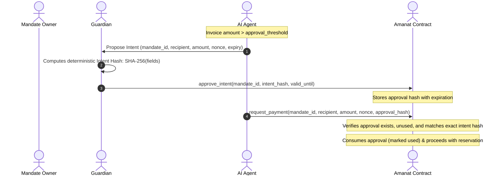

# Amanat: Architecture and System Specification

## 1. System Overview

Amanat enforces on-chain spending mandates for autonomous AI agents on NEAR Protocol.

### Core Premise
In traditional agent architectures, agents hold full-access keys or funded wallets. If the agent's prompt is hijacked or its key compromised, an attacker can drain the entire balance. Amanat decouples custody from spending authority:
- **Custody:** Funds are locked in the Amanat contract vault under an owner-defined mandate.
- **Spending Authority:** The agent holds only a scoped `FunctionCall` access key restricted exclusively to `request_payment` on the Amanat contract.
- **Enforcement:** The contract atomically validates rules (budget, per-payment cap, recipient allowlist, expiration, guardian approvals) and reserves funds *before* initiating NEP-141 token transfers.
- **Gasless for Agents:** Payments are packaged as NEP-366 `DelegateAction` payloads and relayed by a lightweight facilitator that sponsors NEAR gas.

```
+-----------------------------------------------------------------------------------+
|                                 AMANAT SYSTEM                                     |
|                                                                                   |
|  +--------+        1. Create & Fund         +----------------------------------+  |
|  | Owner  | ------------------------------> |      Amanat Contract Vault       |  |
|  +--------+                                 |                                  |  |
|                                             |  - Mandates (Rules & Balances)   |  |
|  +----------+       2. HTTP 402             |  - Atomic Fund Reservation       |  |
|  | Merchant | <------------------------+    |  - NEP-141 Token Transfers       |  |
|  +----------+                          |    |  - Callback Settlement / Refund  |  |
|       |                                |    +----------------------------------+  |
|       | 3. Payment Request             |                     ^                    |
|       v                                |                     | 5. Relay Tx        |
|  +----------+   4. Signed Delegate     |            +------------------+          |
|  |  Agent   | -------------------------+----------> |   Facilitator    |          |
|  | (FC Key) |   (NEP-366 payload)                   | (Gas Sponsorship |          |
|  +----------+                                       |  & Verification) |          |
|                                                     +------------------+          |
|  +----------+                                                |                    |
|  | Guardian | -- Tighten / Approve / Resolve Stale --------->+                    |
|  +----------+                                                                     |
+-----------------------------------------------------------------------------------+
```

---

## 2. Interaction Flows & Sequence Diagrams

### 2.1 Standard Payment Flow (x402-style)

```mermaid
sequenceDiagram
    autonumber
    actor Agent as AI Agent (FC Key)
    actor Merchant as Merchant Service
    actor Facilitator as Amanat Facilitator
    actor Contract as Amanat Contract
    actor Token as NEP-141 Token (USDC)

    Merchant->>Agent: HTTP 402 Payment Required (payTo, amount, mandate, asset)
    Note over Agent: Validates invoice against local constraints
    Agent->>Agent: Signs NEP-366 DelegateAction (request_payment)
    Agent->>Facilitator: POST /settle (PAYMENT-SIGNATURE: Delegate + Requirements)
    
    Note over Facilitator: Verifies delegate signature, FC key allowance, nonces
    Facilitator->>Contract: Broadcast signed delegate transaction
    
    activate Contract
    Note over Contract: Check recipient in allowlist
    Note over Contract: Check amount <= per_payment_cap
    Note over Contract: Check spent + reserved + amount <= budget
    Note over Contract: Atomically increment reserved
    Contract->>Token: ft_transfer(receiver: merchant, amount)
    deactivate Contract
    
    Token-->>Contract: Callback: on_payment_done(mandate_id, request_id, amount)
    activate Contract
    alt Transfer Succeeded
        Note over Contract: reserved -= amount; spent += amount
        Contract-->>Contract: Emit EVENT_JSON: settled
    else Transfer Failed
        Note over Contract: reserved -= amount
        Contract-->>Contract: Emit EVENT_JSON: refunded
    end
    deactivate Contract

    Facilitator->>Merchant: Transaction finalized with receipt outcome
    Merchant->>Agent: HTTP 200 OK + Resource Delivery
```

### 2.2 High-Value Payment with Guardian Approval



---

## 3. Trust Boundaries & Threat Model

| Boundary | Actor / Component | Trust Level | Mitigations & Invariants |
|---|---|---|---|
| **Agent Key** | AI Agent | Untrusted / Adversarial | Holds `FunctionCall` key strictly limited to method `request_payment` on the Amanat contract with 0 allowance to attach deposits. Cannot call `approve_intent`, `tighten`, `loosen`, or `withdraw`. Injections cannot exceed `per_payment_cap` or `budget`. |
| **Relayer / Facilitator** | Facilitator Service | Semi-Trusted | Verifies delegate signature off-chain before broadcast. Validates that signer key is a valid FC key on the contract. Rate-limits requests per IP and per agent. Cannot forge signatures or alter delegate parameters. Replays prevented by on-chain nonces and off-chain cache. |
| **Contract Vault** | Amanat Smart Contract | Fully Trusted Core | Enforces two-phase commit: reserves funds *before* external token transfer promise. If promise fails or times out, callback refunds reserved balance. Contract state is immutable (keys burnt on testnet deploy; no `migrate` entrypoint). |
| **Guardian** | Guardian Role | Trusted Sentinel | Can `tighten` limits (shrink budget, lower cap, remove recipients, shorten expiry) at any time. Can `loosen` limits only up to deposited funds. Can `resolve_stale` requests after `STALE_TIMEOUT_BLOCKS`. Kept on separate key from owner and agent. |
| **Owner** | Mandate Creator | Full Vault Authority | Can revoke mandate and withdraw unspent remainder (`deposited - spent - reserved`). Cannot withdraw funds currently locked in active reservations until callback or `resolve_stale` settles them. |
| **Token Contract (K-3)** | NEP-141 Token Pool | External Dependency | **Acknowledged limitation (K-3):** All mandates for a token share the contract's NEP-141 balance. A malfunctioning token or stuck external callback could affect aggregate accounting. **Mitigation:** Recommended deployment model is one Amanat contract per owner/tenant. |

---

## 4. Glossary

- **Mandate:** An on-chain spending policy binding an owner, agent, guardian, token, cumulative budget, per-payment cap, approval threshold, allowlisted recipients, and expiration.
- **Function-Call Access Key:** A NEAR cryptographic key restricted to calling specific contract methods (`request_payment`) with a designated allowance and receiver ID, incapable of transferring NEAR or calling arbitrary contracts.
- **DelegateAction (NEP-366):** An off-chain signed payload containing actions that an authorized relayer wraps and submits to the blockchain, paying the transaction gas on behalf of the signer.
- **Intent Hash:** Deterministic 32-byte SHA-256 digest binding `(mandate_id, recipient, amount, nonce, mandate_expiry)`. Ensures guardian approvals cannot be replayed or redirected to other recipients or amounts.
- **Reservation (`reserved`):** Atomic hold placed on mandate funds immediately upon `request_payment` execution to guarantee that concurrent requests cannot exceed the cumulative budget.
- **Stale Resolution (`resolve_stale`):** Fallback mechanism allowing the guardian to clear a pending reservation if an external token transfer callback does not finalize within a predefined block threshold.
- **x402-style:** HTTP 402 payment flow utilizing Amanat's custom headers and endpoints (`/verify`, `/settle`, `/supported`) tailored for function-call keys and delegate actions, rather than the standard x402 `exact` scheme.

---

## 5. Architectural Decision Records (ADRs)

### ADR-001: Adopt Custom x402-style Flow Instead of x402 Exact Scheme

- **Status:** Accepted
- **Date:** 2026-10-30
- **Context:** The standard x402 specification for NEAR (`scheme_exact_near.md`) mandates that payments consist of a single `ft_transfer` transaction signed by the payer with an attached deposit of 1 yoctoNEAR. This specification explicitly forbids `FunctionCall` access keys because function-call keys cannot attach arbitrary deposits to external token contracts. Furthermore, `@x402/core` client controls only evaluate individual payments, lacking cumulative budget enforcement.
- **Decision:** Amanat implements an **x402-style** HTTP 402 interface (`/verify`, `/settle`, `/supported`, `PAYMENT-SIGNATURE` headers) where the payment payload is an NEP-366 `DelegateAction` executing `request_payment` via an authorized facilitator.
- **Consequences:** 
  - Standard x402 client libraries cannot pay Amanat merchants without our client adapter.
  - Amanat provides genuine security for AI agents: agents cannot be exploited beyond mandate constraints because custody remains in the vault and keys are structurally restricted.
  - Transparently documented in README and documentation to prevent misaligned expectations.

---

### ADR-002: Immutable Smart Contract Architecture

- **Status:** Accepted
- **Date:** 2026-10-30
- **Context:** Smart contract upgradeability (`migrate` methods or upgrade keys) introduces central points of failure, governance risk, and vulnerability to unauthorized logic modification during or after the hackathon.
- **Decision:** The Amanat smart contract is completely **immutable**. No `migrate` method or self-upgrade mechanism is included in the contract code. During deployment, the contract's full-access key is deleted after initialization.
- **Consequences:**
  - Contract logic cannot be modified once deployed.
  - Bug fixes or parameter overhauls require deploying a new contract and migrating funds via the standard `revoke` -> `withdraw` path.
  - Greatly elevates audit readiness and guarantees for participants: zero admin backdoor risk.
